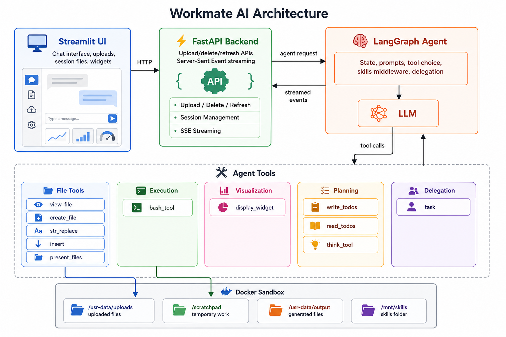
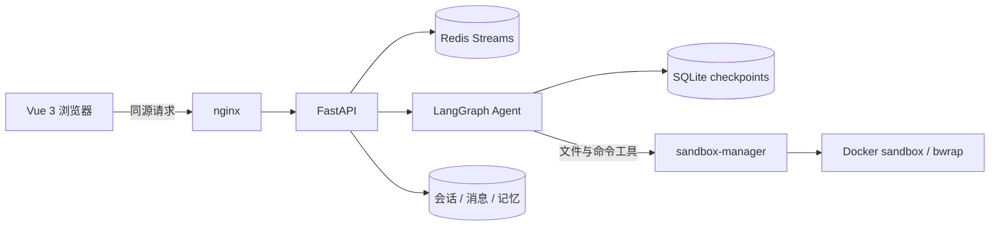

<div align="center">

# Deskwork

**在隔离沙箱里处理文件、交付成果的 AI 工作台**

上传 PDF / Word / PPT / Excel,让 Agent 在沙箱中读取、分析、改写,最后把文件交付给你。

[](LICENSE)


</div>



## 简介

Deskwork 是一个类似 Claude 文件助手的 Agent 运行时。用户在对话中上传文件,Agent 通过 bash、Python 和一组文件工具在 **Docker 沙箱**里完成读取、转换和生成,再把成品作为可下载、可预览的文件交回。命令的执行与宿主机隔离,每个会话有独立的文件目录。

这个项目的重点是把"能干活的 Agent"做成一个完整、可自托管的系统,而不只是一个聊天界面:

- **安全地执行**:沙箱断网、只读根文件系统、bwrap 会话隔离、seccomp、危险命令确认、不可信内容标记。
- **可靠地交付**:交付前校验文件能否打开,保留历史版本,支持编辑重发和文件回退。
- **可追溯地回答**:文档回答可以点开原文出处(PDF 页码、PPT 幻灯片、Word 段落、文本行号),并校验文件是否被改过。
- **可长期运行**:SSE 断线续流、切换会话后任务继续、取消、预算限制、模型回退、工具失败重试。

## 功能特性

### Agent 与工具

- **沙箱执行**:在 Docker 沙箱里运行 bash 和 Python,每个会话一个隔离的工作区。
- **文档处理**:用容器内的库处理 PDF、DOCX、PPTX、XLSX、图片和常见文本格式(Markdown、CSV、JSON、HTML、YAML 等)。
- **技能(Skills)**:基于文件系统的技能库,启动时扫描 `SKILL.md`,按需注入 Agent 上下文。
- **子 Agent**:可把可视化等任务委派给专门的子 Agent,并可启用多角色协作(`MULTI_AGENT`)。
- **任务清单**:内置 TODO 工具,多步任务的计划在界面中实时展示。
- **主动提问**:需求不明确时,Agent 通过 LangGraph `interrupt` 向用户发起单选、多选或自由文本提问,回答后从原工具调用处继续。
- **HTML 可视化**:在对话里渲染自包含的 HTML 图表和组件,运行在 `sandbox` iframe 内。
- **MCP 客户端**:通过 `MCP_SERVERS` 接入外部 MCP 服务,其工具并入 Agent;除非工具声明只读且封闭,否则需要用户确认。
- **联网检索**(默认关闭):通过 DeepSeek Search & Fetch API 搜索和抓取网页,抓取未知 URL 前先询问用户,结果按不可信内容处理。
- **长期记忆**(默认关闭):`remember` / `recall` / `forget`,BM25 召回,TTL 加 LRU 淘汰,写入需用户确认。
- **看图与自检**(可选):配置视觉模型后,Agent 能查看上传的图片,并把生成的文档渲染成图片检查版式。

### 文档检索与原文引用

- 对长文档按块做 BM25 检索(中文单字加二字组合分词),可选向量检索并用 RRF 融合。
- 回答带原文出处:PDF 物理页、PPTX 幻灯片、DOCX 段落范围、文本行范围,保存摘录和 SHA-256 指纹。
- 点击引用打开预览;文件内容变化时返回 409,界面提示重新检索,不展示错位的原文。

### 会话与文件

- **流式响应**:Redis Streams 承载事件,SSE 按最后事件 ID 续流;切换会话后后台继续运行,回来可接回。
- **编辑重发 / 重新生成**:选择历史 checkpoint,通过暂存目录与恢复记录恢复 `output/` 和 `scratchpad/`;快照不可用时明确选择仅回退对话。
- **交付版本**:每个交付文件保留 1 份当前副本和最多 5 个历史版本,可在界面查看文本差异。
- **交付前校验**:检查空文件、Office 文件结构、PDF 文件头、JSON 与 CSV 能否解析。
- **预览**:Office 文件在沙箱里转成 PDF 预览;支持拖拽和粘贴上传。
- **备份与迁移**:会话可导出为 zip 备份包并重新导入,导入时按不可信数据校验路径、大小、哈希和 checkpoint 类型。
- **存储管理**:查看各类占用,清理历史版本和暂存目录。
- **多用户隔离**:会话、文件和记忆按 API Key 的哈希隔离。

### 工程质量

- 每轮预算保护:限制模型调用次数、token 数和重复的工具调用。
- 多模型:OpenAI、Anthropic、DeepSeek、Ollama、vLLM、Azure,支持命名配置和失败自动回退。
- `evals/` 评测框架:驱动真实 HTTP API,结合规则检查和 LLM 评审。
- 后端 pytest 套件、前端 vitest;`make check` 执行静态检查、前端测试与构建,后端全量测试运行 `make backend-test`。

## 系统架构



| 层 | 说明 |
| --- | --- |
| 前端 | Vue 3 + TypeScript + Pinia + Naive UI,由 nginx 托管。nginx 同源代理 API 并注入 API Key,Key 不会进入浏览器 bundle |
| 后端 | FastAPI,负责会话、文件、SSE 事件流和 Agent 调度 |
| 事件流 | Redis 保存短期可续读事件;运行状态、请求幂等与归属由 SQLite Run 记录维护 |
| 运行协调 | SessionRegistry 统一运行、清理与导出的会话占用;完成、失败、取消走同一收尾流程 |
| Agent 运行时 | LangGraph / LangChain,带摘要、技能、工具守卫、记忆、模型回退和 prompt caching 中间件 |
| 沙箱 | 只有 `sandbox-manager` 挂载 Docker 套接字,后端经它的固定接口操作沙箱容器 |

沙箱里的虚拟工作区如下,宿主机数据位于 `sandbox_data/`:

| 虚拟路径 | 宿主机路径 | 用途 |
| --- | --- | --- |
| `/workspace/uploads` | `sandbox_data/sessions/<id>/uploads` | 用户上传的文件(只读) |
| `/workspace/scratchpad` | `sandbox_data/sessions/<id>/scratchpad` | 临时工作目录 |
| `/workspace/output` | `sandbox_data/sessions/<id>/output` | 交付给用户的成品 |
| `/workspace/skills` | `sandbox_data/default_skills` | 共享只读技能库 |

更完整的设计取舍和长期约束见 [设计说明](docs/DESIGN_NOTES.md)。
本次架构改进、关键代码、验证结果、部署状态及 AI 审查重点统一见 [重构审查交接文档](docs/architecture/deskwork-architecture-refactor.md)。

## 技术栈

- **后端**:Python 3.12、FastAPI、SQLAlchemy、LangChain / LangGraph、uv
- **前端**:Vue 3、TypeScript、Vite、Pinia、Naive UI
- **基础设施**:Redis、SQLite、Docker Compose、nginx
- **沙箱**:bubblewrap、seccomp、LibreOffice,以及 PyMuPDF、python-docx、python-pptx 等文档库
- **模型**:OpenAI、Anthropic、DeepSeek、Ollama、vLLM、Azure

## 快速开始

### 前置条件

- Docker(Docker Desktop 或 Docker Engine)和 Docker Compose
- 一个支持函数调用的 LLM API Key,或本地的 Ollama / vLLM 服务

> 小型本地模型的工具调用通常不稳定,建议使用支持 function calling 的模型。

### 1. 配置环境变量

```bash
cp .env.example .env
```

编辑 `.env`,至少填写下列变量:

| 变量 | 说明 |
| --- | --- |
| `LLM_PROVIDER` | `openai`、`anthropic`、`deepseek`、`ollama`、`vllm` 或 `azure` |
| `LLM_API_KEY` | API Key(Ollama / vLLM 填任意值) |
| `LLM_MODEL_NAME` | 模型名,例如 `gpt-4o`、`claude-sonnet-4-5`、`deepseek-chat` |
| `LLM_BASE_URL` | `deepseek` / `ollama` / `vllm` 必填,`anthropic` 中转站也要填;`openai` 留空则用官方地址。OpenAI 风格地址需要 `/v1`,`anthropic` 不需要 |
| `LLM_API_VERSION` | 仅 `azure` 使用 |
| `REDIS_PASSWORD` | Redis 密码,Compose 必填,可用 `openssl rand -hex 24` 生成 |

### 2. 启动

```bash
docker compose up --build
```

| 服务 | 地址 |
| --- | --- |
| Web 界面 | http://localhost:8088 |
| 后端 API | http://localhost:5001(仅绑定本机),文档见 `/docs` |
| Redis | 仅 Compose 内部网络可访问 |
| 沙箱 | 名为 `sandbox` 的 Docker 容器 |

### 3. 开始使用

打开 http://localhost:8088,上传一份文件并提出需求,例如"把这份报告整理成 5 页的 PPT"或"统计这张表里每个月的销售额并画图"。

## 配置参考

以下为可选变量,完整列表和注释见 [`.env.example`](.env.example)。

| 变量 | 说明 |
| --- | --- |
| `API_KEYS` | 后端接受的 API Key,逗号分隔。留空即关闭认证(仅限本地开发)。通过 `Authorization: Bearer <key>` 或 `X-API-Key` 传递 |
| `API_KEY` | nginx 给未带 Key 的请求注入的默认 Key(须是 `API_KEYS` 之一)。多人使用时留空,每人在页面里填自己的 Key |
| `WEB_PORT` / `WEB_BIND` | Web 界面端口(默认 `8088`)和绑定地址(默认 `127.0.0.1`)。对外暴露前请先加认证 |
| `CORS_ORIGINS` | 允许的跨域来源,逗号分隔 |
| `RATE_LIMIT_PER_MINUTE` / `RATE_LIMIT_SEND_PER_MINUTE` | 每个调用方的限流,`send-message` 有更严格的单独限额 |
| `DATA_DIR` / `DATABASE_URL` | SQLite 位置,或用 SQLAlchemy URL 切换数据库 |
| `LOG_LEVEL` / `LOG_FILE` | 日志级别和文件路径,置空则不写文件。日志不记录消息和工具输出正文 |
| `AGENT_MAX_LLM_CALLS` / `AGENT_MAX_TOTAL_TOKENS` / `AGENT_MAX_REPEATED_CALLS` | 每轮预算:模型调用数、总 token、连续重复的工具调用(`0` 表示关闭该项) |
| `SUBAGENT_MAX_LLM_CALLS` | 单次子 Agent 委派的模型调用上限,默认 `15` |
| `CONFIRM_RISKY_COMMANDS` | 危险 bash 命令(`rm`、覆盖上传文件、递归 chmod 等)执行前询问用户,默认 `true` |
| `TOOL_POLICY` | 按工具设置 `allow` / `confirm` / `deny` |
| `LLM_<NAME>_*` | 命名模型配置,如 `LLM_DEEPSEEK_API_KEY`、`LLM_DEEPSEEK_MODEL_NAME` |
| `LLM_PROFILE` / `LLM_FALLBACKS` | 选择主模型配置,以及主模型失败时依次切换的备用配置 |
| `LLM_MAX_TOKENS` | Anthropic 协议模型的单次回复输出上限,默认 `8192` |
| `LLM_REQUEST_TIMEOUT_SECONDS` / `AGENT_RUN_TIMEOUT_SECONDS` | 模型 HTTP 请求超时默认 180 秒;执行片段总时限默认 1800 秒,后者设为 `0` 可关闭 |
| `MEMORY_ENABLED` / `MEMORY_*` | 长期记忆开关、默认保留天数、最大条数、写入是否需确认 |
| `MCP_SERVERS` / `MCP_CONFIRM_TOOLS` | 外部 MCP 服务(stdio / http / sse)的 JSON 配置,以及是否需要确认工具调用 |
| `WEB_TOOLS_API_KEY` / `WEB_*` | 启用 `web_search` / `web_fetch`。按成功请求计费,查询和 URL 会发送给 DeepSeek |
| `REVIEW_LLM_PROFILE` | 视觉模型配置。设置后启用文档版式自检和 `view_image`,会额外消耗 token |
| `EMBEDDING_BASE_URL` / `EMBEDDING_API_KEY` | 兼容 OpenAI 的 `/embeddings` 服务,启用后文档检索改为向量加 BM25 混合,文档片段会发送给该服务 |
| `LANGSMITH_*` | 可选的 LangSmith 追踪 |
| `PIP_INDEX_URL` | 仅构建沙箱镜像时使用的 PyPI 镜像地址,下载慢时可设为国内镜像 |

## API

| 方法 | 路径 | 说明 |
| --- | --- | --- |
| `GET` | `/health` | Redis 与数据库存活检查;`/health/deep`(需 Key)额外检查 LLM |
| `POST` | `/send-message` | 提交用户消息和可选文件,返回 `prompt_id` |
| `POST` | `/stream-events` | 按 `prompt_id` 以 SSE 返回 Agent 事件 |
| `GET` | `/thread-status/{session_id}` | 查询会话当前的生成状态 |
| `POST` | `/thread-cancel/{session_id}` | 取消进行中的运行 |
| `GET` | `/files/download` | 下载 `uploads/` 或 `output/` 里的会话文件 |
| `GET` | `/conversations` | 会话列表 |
| `GET` | `/conversations/{id}/messages` | 消息历史 |
| `GET` | `/runs/{run_id}` | 持久运行状态、错误与已保存的展示快照 |
| `GET` | `/conversations/{id}/requests/{request_id}` | 响应丢失后按原请求 ID 查询已接受的 Run |
| `PATCH` | `/conversations/{id}` | 重命名会话 |
| `DELETE` | `/conversations/{id}` | 删除会话及其文件 |

典型调用流程:

1. `POST /send-message`,带上 `session_id`、`user_query` 和可选文件。
2. 收到 `{ "prompt_id": "..." }`。
3. `POST /stream-events`,带上 `session_id` 和 `prompt_id`,消费 SSE 事件。
4. 需要时调用 `POST /thread-cancel/{session_id}` 取消。
5. 流中出现 `ask.user` 事件时,线程状态变为 `waiting`。把用户的回答通过同一个 `POST /send-message` 发回,即可恢复被暂停的工具调用。
6. 编辑或重新生成时,给 `POST /send-message` 传 `rewind_to_message_id`。

## 技能(Skills)

技能存放在 `sandbox_data/default_skills`,挂载到沙箱的 `/workspace/skills`。每个技能是一个带 `SKILL.md` 的目录,可附带文档和脚本。后端读取 `SKILL.md` 的 frontmatter,通过中间件把可用技能注入 Agent 上下文。

内置技能:

- `pdf`、`docx`、`pptx`、`xlsx`:对应格式的读取、编辑和生成。
- `data-analysis`:表格数据的编码识别(含 GBK)、分析流程、结果校验和带中文的图表。Deskwork 自写。
- `format-conversion`:`.doc/.xls/.ppt`、Markdown、PDF 之间的转换路线和保真度说明。Deskwork 自写。
- `theme-factory`:10 套配色与字体主题,用于幻灯片、文档和 HTML(来自 [anthropics/skills](https://github.com/anthropics/skills),Apache 2.0)。
- `doc-coauthoring`:协作撰写规格、方案和决策文档的多轮流程(来自 anthropics/skills)。

后两个技能在末尾带有 "Deskwork Notes" 小节,说明它们在本运行时的适配(`ask_user_input` 限制、无 artifacts 和 connectors、沙箱字体)。


## 项目结构

```text
.
├── backend/
│   ├── app/
│   │   ├── api/            # FastAPI 路由与鉴权
│   │   ├── services/       # 聊天、文件、检索、导入导出等业务逻辑
│   │   ├── agents/         # Agent 构造、LLM 工厂、提示词、中间件、子 Agent
│   │   ├── tools/          # Agent 工具(bash、文件、检索、联网、记忆、提问、TODO、可视化)
│   │   ├── sandbox/        # sandbox-manager 客户端、命令校验、路径转换
│   │   ├── db/             # 数据模型与仓储层
│   │   └── config/         # 环境变量配置
│   ├── tests/              # pytest 测试
│   └── main.py             # 入口
├── frontend/               # Vue 3 前端(组件、Pinia store、API 客户端)
├── sandbox/                # 沙箱镜像、sandbox-manager、seccomp 配置
├── sandbox_data/           # 内置技能与各会话的运行数据
├── evals/                  # 评测用例、运行器、规则检查与 LLM 评审
├── docs/                   # 设计说明与部署文档
└── docker-compose.yml      # Redis、沙箱、sandbox-manager、后端、Web
```

## 开发与测试

```bash
make check          # 后端 Ruff 检查,前端测试与构建
make backend-test   # 后端 pytest
make sandbox-verify # 验证沙箱隔离
```

需要完整服务栈的集成检查请使用 `docker compose`。

## 已知限制

- **共享沙箱容器**:所有会话在同一个沙箱容器内执行。会话在文件系统和 bash 会话层隔离,但共享容器运行时。
- **危险命令确认基于黑名单**:检查命令位置上的词,并递归 `bash -c`、`eval`、包装命令和命令替换。藏在脚本文件里或由变量拼出的删除操作可能漏过。它是启发式过滤,不是隔离边界。
- **语义检索可选**:默认只有 BM25。启用向量检索会把文档片段发给 embedding 服务,超过 `EMBEDDING_MAX_CHUNKS` 的文档退回 BM25。
- **分支不可浏览**:编辑重发会回退对话,被放弃的分支留在 checkpoint 里,但界面不能切换过去。文件回退依赖每轮快照,快照受数量和大小限制。
- **单进程**:Run 状态持久化,任务与取消句柄保留在进程内存,后端只能部署一个实例。重启后标记中断并保留已有历史,不会自动重放原脚本。
- **用户即 API Key**:没有账号和密码体系,换 Key 就换身份,原数据不再可见。
- **配额按会话计算**:存储和单文件大小按会话限制,`MAX_CONCURRENT_RUNS` 限制全局并发运行数,CPU 和内存限制作用于整个沙箱容器。
- **依赖与网络受限**:运行时安装新库和任意联网都被有意禁止。
- **引用范围**:xlsx 暂无单元格级引用;扫描版 PDF 没有自动 OCR 检索链路;引用定位准确不等于回答结论正确。

## 参与贡献

欢迎提交 Issue 和 Pull Request,尤其是运行时、沙箱模型、技能、文件处理、测试和界面方面的改进。

1. Fork 本仓库并创建聚焦的功能分支。
2. 完成修改。
3. 运行 `make check` 和 `make backend-test`。
4. 提交 Pull Request,清楚描述改动内容。

## 许可证

基于 [MIT License](LICENSE) 开源。
