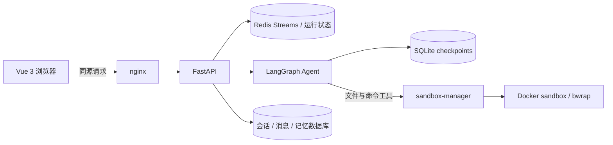

# 设计说明

根据 2026-11-01 当前工作区代码整理。本文解释现有实现、长期约束和已完成的验证记录。运行配置见 [README](../README.md)，旧数据迁移见 [DEPLOY_NON_ROOT](DEPLOY_NON_ROOT.md)。

## 1. 整体结构与数据归属

- Compose 中只有 sandbox-manager 挂载 Docker 套接字，后端只经它的固定操作接口使用沙箱（必须配置 `SANDBOX_MANAGER_URL`），不再保留直接调用 Docker CLI 的客户端。
- 会话 ID 同时作为 LangGraph thread ID 和文件目录名。API 与路径层校验其格式。
- 会话、文件访问和长期记忆按 `owner` 隔离。owner 是 API Key 的 SHA-256 前缀，不是账号体系；换 Key 即换身份。未启用认证时共用空 owner。
- 会话数据库默认 SQLite，可通过 SQLAlchemy URL 配置；LangGraph checkpoint 单独使用 SQLite。Redis 承载流、prompt 注册和线程状态。
- 后端以非 root 用户运行，UID 与沙箱 agent 一致；代码只读，日志默认在数据卷内，支持级别设置与轮转。

## 2. 一轮请求与历史恢复

1. `POST /send-message` 校验归属、并发和输入，保存附件，尝试保存本轮前的文件快照，记录用户消息，返回 `prompt_id`。
2. 后台 `asyncio.Task` 调用 Agent 的 `astream(messages, updates, custom)`，把统一事件写入 Redis Stream。
3. 前端通过 `POST /stream-events` 接收 SSE，以最后事件 ID 续流；`block_ms` 限制为 0–4000，流有保留期限，过期后不能无限重放。
4. `TurnRecorder` 将 text、tool_call、tool_result、files、widgets、sources、ask 等消息部分落库，重要事件后保存运行快照；终态先落库再结束事件流。
5. 切换会话会断开当前浏览器订阅，后台继续运行。再次进入运行中的会话可接回事件流；侧栏按状态显示标记（生成中、等待回答、完成未读、失败、取消），状态存库，见下文“会话列表状态”。

主要事件：`upload.complete`、`user.message`、`ai.token`、`ai.tool_call`、`tool.result`、`files.presented`、`widget.presented`、`sources.presented`、`ask.user`、`usage`、`error`、`stream.end`。

**单进程约束：** 活跃任务和并发占位在进程内管理。启动时将残留运行状态和未完成助手消息标为错误；这不是分布式 worker，也不支持重启后继续执行原任务。取消会清理沙箱 shell，并修复未完成的工具调用消息。

入口：[chat_operations.py](../backend/app/services/chat_operations.py)、[history.py](../backend/app/services/history.py)、[chat.ts](../frontend/src/stores/chat.ts)。

### 近期修复后的约束

- 交付记录的 `container_path` 指向 `output/` 下的副本,下载接口只允许 `uploads/` 与 `output/`。更早版本记成 `scratchpad/` 原路径的旧记录,在 `/conversations/{id}/messages` 与 `/assets` 读出时改指向同名的 `output/` 副本(库内数据不改);副本已被删除则仍下载失败。
- 助手消息终态写库有限重试(同一行更新,不重复建消息);仍失败时发带 `code: history_save_failed` 的 `error` 事件并置 `error`,不报 `complete`。前端据此把它显示成消息下方的警告,回答本身不标为出错。
- 并行提问时一次只发一张卡片;恢复按 interrupt id 回答最早未答的一个。
- 编辑重发:上传、注册 prompt、置 running、推送事件都成功后才执行 `_rewind`,之前失败不动历史和 checkpoint。
- 删除与启动互斥:启动中的会话删除返回 409,删除期间启动返回 `ActiveRunError`。
- Office 预览缓存按文件内容哈希;转换期间源文件变化的结果不入缓存。
- `refresh_running_ttl` 同时续期 prompt 归属集合。
- 会话列表状态:终态(complete/waiting/error/cancelled)和未读标记存库,运行中不入库而看 Redis 实时状态,所以崩溃不会留下假的“生成中”;新一轮开始清除旧终态,打开会话清未读,“等待回答”只在回答后消失。
- 交付记录带 `sha256`/`size`。历史消息的文件卡片按摘要经 `/files/delivered` 取回当时版本,版本被裁剪返回 410;没有摘要的旧记录只能下载最新版本。
- 发送去重:`send-message` 带 `client_request_id` 时,服务端在进程内按 (owner, session, ID) 记住已接受的请求,重试返回原 `prompt_id`;同 ID 内容不同返回 400。只有启动成功才记录。前端重试用尽仍是网络错误(没有 HTTP 响应)时,会查 `thread-status`:线程在运行就按“已接受”接回该轮事件流;不在运行时再取最近一页消息,最新一条用户消息比发送前本地已知的 id 都新且文字相同,就算已接受(那一轮已经跑完),按服务端重新载入消息、不把文字放回输入框,否则恢复原界面;服务端明确拒绝(`ApiError`)都不查。
- 长对话分页:前端只加载最近 40 条,更早的按 `before_id` 向上翻;`from_id` 取"最早已加载消息及之后"的全部。未加载部分的上传文件、交付文件、计划由 `/conversations/{id}/assets` 补全,仅 `hasEarlier` 时参与计算。滚动到消息列表顶部会自动加载上一页,“加载更早消息”按钮保留。导出不分页。
- 交付前校验:`present_files` 复制到 output 之前由 `deliverable_check` 检查空文件、docx/xlsx/pptx(zip 结构与主部件为合法 XML)、PDF(文件头与 `%%EOF`)、json(能按 UTF-8 解析)、csv(UTF-8/GBK 能解码、无 NUL、引号闭合,不检查列数一致)。失败抛错且不动 output 里上次交付的副本;同一文件连续失败 3 次后照常交付并附警告(计数在进程内存)。只检查结构能否打开,不判断内容是否符合任务。
- 看图:`view_image` 只在配置了 `REVIEW_LLM_PROFILE`(与文档自检共用视觉模型)时注册;未配置时系统提示明确告知"看不到图片",不得猜测。工具只读 `uploads/`、`output/` 下的 png/jpg/jpeg/webp/gif,经 `read_host_file` 读取(不跟随符号链接),单张上限 `VIEW_IMAGE_MAX_MB`(默认 5),每个用户轮次最多 `VIEW_IMAGE_MAX_PER_TURN`(默认 5)次,每次一张;结果按不可信内容包装。图片不会自动随消息送给主模型,必须由模型调用工具。没有压缩或缩放,大图受大小上限限制;只在主 Agent 可用,子 Agent 没有该工具。入口:[image_view.py](../backend/app/services/image_view.py)、[image_tools.py](../backend/app/tools/image_tools.py)。
- 预览旁修改:预览抽屉的“提交修改”把“请修改文件 <路径>:<要求>,修改后用原文件名重新交付”作为普通消息发出,成功接受后关闭抽屉;重新交付同名文件时旧版自动进入历史。只针对当前文件。
- 草稿:输入框文字写入 `localStorage`,键含 API Key 的短哈希(不存 Key 本身),换身份看不到旧草稿;已有会话按 id 存,未发出第一条消息的新对话共用一个槽位且只在页面加载后的第一个新对话里恢复。发送成功、删除会话时清除;每个身份最多 50 条、单条 20000 字,超出丢弃最久没改的;存储不可用时静默降级为仅内存。附件内容不保存,只记文件名(每条最多 20 个):刷新后输入框上方提示“刷新前选择的附件没有保存,请重新选择”,重新选了同名文件、点“知道了”或发送后提示消失。
- 存储:`GET /files/storage` 返回上传、产出、暂存、历史版本、回退快照各自的字节数;配额口径不变,只算前三类。`DELETE /files` 只删 `uploads/`、`output/` 下的单个文件,生成中 409、越界 400、目标是符号链接只删链接,历史版本不连带删除(独立副本仍占空间)。前端用 `GET /files/list`(磁盘上现有文件,上限 5000)把已删除的文件从右侧面板隐藏;聊天里的历史卡片不隐藏,下载得到 404。`DELETE /files/versions` 清空全部文件的历史版本(只删带数字名的历史副本,保留各文件的 `.current`),生成中 409;`DELETE /files/scratchpad` 清空暂存目录内容(符号链接只删链接),生成中同样 409。前端在存储占用的“历史版本”和“暂存”行提供带确认的清理按钮。
- 用户消息和附件记录在同一个数据库事务里写入(`add_user_message_with_files`),附件记录写失败时消息一并回滚,不会留下没有附件的用户消息。
- 事件流连续空响应达到 `maxFailures` 后查询线程状态,已结束则报错,仍运行则最多再续 `extraRounds` 轮。
- `ai.token` 只转发图节点 `model`(主模型调用)的输出;摘要中间件和工具内部的模型调用(`view_image`、`review_document`)也会经 messages 流出,不拼进回答。
- 置 running 时就登记 `prompt_id`,快照、写库期间刷新页面也能接回。取消请求落在启动步骤期间时最多等 30 秒(`_START_WAIT_SECONDS`)让任务建起来再取消,不报 409。
- 未完成的工具调用补结果时区分两种文案:用户取消写 "Execution cancelled by user.",出错或预算上限中断写 "...interrupted before this tool call finished.",避免模型误以为用户不要这一步。
- 摘要(`SafeSummarizationMiddleware`)失败时依次试备用模型,全部失败则本次不摘要、保留原历史,下次模型调用前再试;上游默认会用错误文本替换早期对话。
- 工具抛出的异常(MCP 断开、数据库错误等)由 ToolGuard 转成 `status=error` 的工具结果交给模型,不中断整轮。
- Bash 命令期间 shell 自己退出(`set -e`、语法错误等)时报错并带退出码;非零退出不算工具出错,但输出末尾附 `Exit code: N`。
- 文档检索、预览转换、文档自检在 scratchpad 里的中间文件每次调用独立命名,用完即删,不占配额也不进快照。
- 写进文件的 heredoc 正文(`cat`/`tee`)不按 `CommandValidator` 的拦截模式检查;python/bash 的 heredoc 仍检查。
- 记忆召回没有命中时返回 "No matching memories.",不把"最近使用"的几条当搜索结果,也不顺延它们的过期时间。
- 并行 `write_todos` 取最后一次(state 带 reducer),不再让整轮报 `InvalidUpdateError`。

## 3. 沙箱、命令确认与工具权限

- 每个会话映射 `/workspace/uploads`（只读）、`output`、`scratchpad`；`/workspace/skills` 是共享只读技能目录。物理路径由 `SessionPaths` 转换。
- Compose 的 sandbox 断网、限制 CPU/内存/PID、根文件系统只读；bwrap 提供会话挂载和 PID 隔离。上传、宿主读取和输出溢出有符号链接防护。
- 命令串行执行，依赖 cwd 的校验在取得 BashSession 锁后进行。结束标记每次带随机 nonce；超时、取消及输出超限会结束相应 shell。shell 按空闲时间和 LRU 回收。
- manager 给每个 bwrap 加唯一的 `DESKWORK_SPAWN_ID` 标记（在 `--clearenv` 前设置，agent 环境里看不到），结束时只杀它；按会话目录匹配会连带杀掉同会话里并行的一次性 bwrap 和刚重启的 shell。manager 拒绝启动（4401 认证、4429 并发 shell 达到 `MANAGER_MAX_SPAWN`、4400 参数）时，错误信息写明原因。
- 文件工具（`view_file`、`str_replace` 等）、看图、预览和版本读取都在后端经 bind mount 读宿主文件：解析后必须仍在本会话目录（或 skills）内，再以 `O_NOFOLLOW` 打开（`read_host_file` / `open_host_file`）。沙箱的 `/exec` 不在 bwrap 内，看得到所有会话目录，不能交给它读。
- 删除会话先在宿主侧删目录，删不干净（属主不一致等）才让 manager 以 root 清理。
- manager 的 `/provision`（每个后端进程首次用到某会话时调用）只改顶层目录：会话根与 `uploads` 775，`output`、`scratchpad` 归 agent 且 777，`snapshots` 归 agent 且 700。不递归：后端与 agent 都是 UID 1000，目录里的文件属主本来就可读写；递归会随文件数变慢，还会给版本和快照文件加上可执行位。
- `CommandValidator` 与 `risky_reason` 是启发式过滤，不是隔离边界。共享 `shell_parse.py` 识别命令位置、包装命令和 heredoc；不要退回对整串文本做关键词匹配。删除工作区文件与删除根目录的处理不同。
- `ToolGuardMiddleware` 在主 Agent 和子 Agent 上都生效，处理 `allow/confirm/deny`、危险 Bash 确认、MCP 确认与不可信内容标记。错误的权限配置在启动时拒绝，未知工具名告警。`TOOL_POLICY` 把 bash 设为 `confirm` 时每条命令只问一次，危险命令不再追加第二次确认。
- `ask_user_input` 和操作确认均通过 LangGraph `interrupt()` 暂停；用户回复仍走 `/send-message`，后端用 `Command(resume=...)` 恢复。中间件必须放行 `GraphBubbleUp`。
- 单轮限制模型调用数、token 和重复工具调用；子 Agent 另有调用上限。只对允许重试的幂等工具在沙箱瞬时故障时退避重试，不自动重试 Bash 与写文件。

`sandbox/seccomp.json` 基于 Docker 默认 profile，为 bwrap 放行命名空间及挂载相关系统调用；AppArmor 保持默认。维护时应对照新的 Docker 默认 profile 重新核对这些放行项，并用实际 bwrap 启动和文件操作验证，不能直接改成 `unconfined`。

## 4. 编辑重发、文件快照与交付版本

- 每轮记录开始前的 checkpoint ID。编辑重发/重新生成时回退 Agent 状态、截断后续会话消息，并复用原附件；不是可切换历史分支的界面。
- 开始前尝试保存 `output`、`scratchpad` 快照，回退时尝试恢复。快照受数量、大小和配置限制，创建/恢复失败会记录日志，不能承诺任何历史节点都能恢复文件。
- 快照不含 scratchpad 顶层的转换中间目录（`_preview`、`_rag`、`_review`，见 `SNAPSHOT_EXCLUDED`）。后端先在宿主侧算出路径、类型、权限、大小、mtime 的指纹（`snapshot_manifest`，目录 mtime 不算）写进快照的 `.manifest`；与最新一份快照相同时用 `cp -al` 建硬链接副本，不再复制内容。快照先写到 `.tmp_` 目录再改名，失败不留残缺快照。硬链接的文件只算一次占用（`dir_size`）。内容改了但大小和 mtime 都没变（例如 `touch -d` 还原时间）时会误判为未变；agent 不会这样写文件，接受这个代价。
- 产物每次交付后保存独立的 `versions/<文件名>/.current`，下次交付不同内容时归档旧副本，避免直接改写 output 丢失上次交付内容。
- 每文件最多保留 5 个历史版本和 1 个当前副本，单份上限 20 MB；临时复制后原子替换，相同内容不重复归档，相同 mtime 不覆盖不同内容。旧版已经丢失的内容无法补回。
- 快照和版本目录不挂进 Agent 的 `/workspace`；删除会话时随数据清理。版本历史和任务回退快照是不同用途。
- 会话备份包（`/files/export`）含消息、uploads/output 文件、sha256 清单和 checkpoint 原始行，不含版本历史与快照；生成中拒绝导出。已压缩的格式（docx/xlsx/pptx、图片、zip 等）不再二次压缩，直接存入。导入（`/conversations/import`）总是建新会话，备份包按不可信数据处理：路径逐段校验、解压限字节、校验 sha256，checkpoint 先过 LangGraph 的安全类型白名单再写库（读 checkpoint 会按模块名 import 并调用，不校验等于任意代码执行），失败整体回滚。实现见 [session_export.py](../backend/app/services/session_export.py)、[session_import.py](../backend/app/services/session_import.py)、[checkpoint_transfer.py](../backend/app/services/checkpoint_transfer.py)。

入口：[chat_operations.py](../backend/app/services/chat_operations.py)、[bash_handler.py](../backend/app/sandbox/bash_handler.py)、[file_versions.py](../backend/app/services/file_versions.py)。

## 5. 文档检索与原文引用

- `search_document` 按块检索，默认 BM25，中文单字加二字组合分词；计数、汇总仍应使用脚本处理全文。
- 文本直接读取；PDF 在沙箱通过 PyMuPDF 按物理页提取，空白页保留页号；pptx 用 python-pptx 按幻灯片提取（含表格与组合形状，空白幻灯片保留编号，不含备注）；docx 用 python-docx 按正文顺序提取非空段落，整张表格算一段（单元格用 ` | `、行用 ` / ` 连接），段内换行压成空格，每段一行，所以行号就是段号；不含页眉页脚、脚注、批注和文本框。xlsx 等其余格式用 `markitdown` 转换后检索。
- PDF/pptx/docx/文本来源带文件路径、摘录、页码/幻灯片号/段落范围/行范围（`location.kind` 为 `page`/`slide`/`paragraphs`/`lines`）和 SHA-256 指纹。`sources.presented` 随历史保存，前端来源按钮和正文链接打开预览，Markdown 导出保存来源锚点与摘录。
- 预览下载对实际返回的同一份字节校验指纹，文件变化返回 409；界面保留旧摘录并提示重新检索，不展示错位原文。
- 索引缓存在进程内，最多 8 个；缓存标识包含纳秒 mtime、ctime、大小与 inode，建索引期间文件变化会拒绝生成该次引用。
- 配置 embedding 后可用向量与 BM25 的 RRF 混合检索；失败或超过分块限制时退回 BM25。向量只在内存，文档段落会发送到 embedding 服务，因此默认不启用。

**能力边界：** pptx、docx 预览只展示检索时的摘录并校验文件未变，不渲染原文件；docx 段号按上述规则计数，与 Word 界面里的段落编号不一定一致（空段落不计、表格算一段）；xlsx 尚无单元格引用；扫描 PDF 没有自动 OCR 检索链路。引用定位可靠不等于回答结论正确，混合检索也没有已确认的对照收益。

入口：[doc_search.py](../backend/app/services/doc_search.py)、[document_sources.py](../backend/app/services/document_sources.py)、[SourcePreview.vue](../frontend/src/components/SourcePreview.vue)。

## 6. 前端与浏览器边界

- Vue 3 + Pinia 管理会话、消息、文件、任务计划和用量。待发附件按会话保存在页面内存，刷新后丢失；输入框文字另存 `localStorage` 草稿（见下条）。发送失败时文字放回输入框。
- 会话搜索、Markdown 导出、Office 转 PDF 预览、历史版本与文本差异、快捷指令、拖拽/粘贴上传已有实现。会话列表与消息列表都有分页（消息见第 2 节“长对话分页”）。
- 后台提醒:页面不可见(`document.hidden`)时,会话生成完成、失败或等待回答会给标签页标题加前缀(`✓ `/`! `/`? `),页面重新可见或窗口获得焦点后恢复;取消不提醒。侧栏“后台通知”开关(`localStorage` 键 `notify`)打开时才向浏览器请求授权,授权后同样条件下再发系统通知。只覆盖本页内的状态变化(含后台轮询到的会话),不依赖 Service Worker,页面关闭后不提醒。实现见 [attention.ts](../frontend/src/utils/attention.ts)。
- Markdown 经 DOMPurify 处理，远程图片替换为占位文字；widget 放在 `sandbox="allow-scripts"` iframe 内，配套 CSP 限制外部访问。
- 页面 CSP 为兼容 Naive UI 与 widget 保留内联脚本/样式及白名单 CDN，主要限制外传通道，不能作为防止页面 XSS 的保证。
- nginx 在请求缺少 Authorization 时注入配置的默认 Key；多人部署应留空该默认值。后端与 web 默认只绑定本机。用户手填 Key 存 localStorage，页面 XSS 仍可能泄露它。
- nginx 用 `add_header_inherit merge`（需要 ≥ 1.29.3）让 location 里的 `Cache-Control` 与 server 级安全头叠加；`index.html` 每次验证（`no-cache`），带 hash 的 `/assets/` 长期缓存。
- 草稿写入延迟约 300 毫秒合并，页面隐藏、关闭或离开聊天视图时立即写掉。输入法确认回车（含 Safari 的 keyCode 229）统一由 `isImeEnter` 判断，不触发发送。删除会话等服务端成功后才中止当前流、清本地状态，删除失败时生成照常继续。

## 7. 模型、记忆、MCP 与子 Agent

- LLM 和 Agent 在首次使用时构造并缓存，配置对象仍在 import 时初始化。支持多 provider、命名 profile 和失败时 fallback；具体配置见 README。看图和文档自检用的命名模型按 profile 缓存（`get_named_model`），复用连接池。
- Anthropic 协议的单次回复上限由 `LLM_MAX_TOKENS`（默认 8192）给出，不再依赖 SDK 按模型名推断（未知模型名会退到 4096）；一次写很长的文件被截断时调大。
- `usage` 保存 token 与实际响应的 `by_model`，不换算费用。旧按工具名的模型路由已移除，MCP 服务端也已决定不做。
- 中转站可能按协议路由到不同模型；配置 Claude 名称却用 OpenAI 协议时有告警。以实际响应及评测结果中的模型字段判断，不能只看请求名称。
- `MEMORY_ENABLED` 默认关；记忆按 owner 隔离，同一 Key 的会话共享。BM25 召回，TTL/LRU 淘汰，写入默认确认；过滤主要靠提示词和用户确认，没有完整敏感信息检测。每轮选中的记忆只加在本次请求里最后一条用户消息的开头（不写入状态），不放进 system：system 带提示缓存标记，记忆一变会让 system 和整段历史都不命中缓存。
- MCP 客户端启动时加载外部工具，只有声明 `readOnlyHint=true` 且 `openWorldHint=false` 的工具免确认（规范里 openWorldHint 缺省为 true）；抓取网页、搜索这类只读但联网的工具也要确认，因为沙箱断网后它们是唯一的外传通道，文档里的注入指令可以让它把数据拼进 URL。部署者可用 `TOOL_POLICY` 把单个工具设为 `allow` 免确认。结果按不可信内容处理。连接失败记录状态，不阻塞整个应用启动。
- `web_search` / `web_fetch` 内置，调 DeepSeek Search & Fetch API，配 `WEB_TOOLS_API_KEY` 才注册。请求由 DeepSeek 服务器发出，后端只连 api.deepseek.com，不存在 SSRF。外传风险在 URL：抓取的 URL 不是用户消息里的、也不在 `web_search` 结果（ToolMessage.artifact）里时要用户确认，问题里给出完整 URL；上传文件、网页正文、命令输出、摘要里的 URL 都不算已知。搜索词只到 DeepSeek，不确认。两者合计每轮有次数上限（按模型发起的调用计数，同一条回复里并行的调用也算进去；`view_image` 同理），结果按不可信内容包裹，长正文截断后全文存 scratchpad（随机名 + O_EXCL + O_NOFOLLOW）。只挂主 Agent，子 Agent 不联网。
- 可视化子 Agent 没有工具，只返回 HTML，由主 Agent 展示。可选 planner/reviewer 默认关闭；“只读”是提示词约束，保留的 Bash 技术上仍能写。
- 子 Agent 挂 ToolGuard 和独立模型调用上限，内部工具事件不转发到主时间线；主轮预算不能替代其独立上限。

## 8. 评测与历史结论的使用

`evals/` 通过真实 HTTP API 驱动任务，结合确定性规则与可选 LLM judge，保存轨迹、token、耗时及模型信息。CI 当前运行后端/前端测试、格式/类型检查、构建和评测框架确定性测试，不运行真实模型对照。

历史记录中影响当前取舍的结论保留如下；这些均来自被合并的旧升级记录，本次未重跑或重新核验原始评测文件，不能当成本次验收或稳定通过率：

- 自检 ON/OFF 对照（5 例 × 2 轮）未观察到排版收益，ON 交付 7/10、OFF 10/10。因此 `review_document` 继续由 `REVIEW_LLM_PROFILE` 显式开启，不宣称“自检提高质量”。
- 旧记录的干净基线为 Agent/judge 均 `claude-sonnet-5-5`、50 例中 41 例通过。10-26 15:05 至 10-27 15:56 的部分旧结果实际模型是 `gpt-5.6-sol`，不能归为 Claude 成绩；随后修正过评测误判，数字不能直接跨版本比较。
- 注入边界开关的旧对照均满分，没有区分力；不能据此宣称防御提升。防编造提示词之后单次小样本通过，也不是稳定保证。
- 记忆和 MCP 曾分别做过单次真实栈验证；记忆评测需启用记忆、使用受控的空记忆库并发 1。多模型对比应固定 judge，并核对 `models`、`judge_models`、`model_warnings`。

2026-10-31 在 claude-sonnet-5-5 上的小样本对照(同一后端,单次运行,不是稳定通过率):

- 长文档问答(5 例)混合检索与纯 BM25 都是 5/5,通过率无差别;混合平均多用约 10–40% token 和约 15–20 秒。没有证据表明混合检索值得默认开启。
- `MULTI_AGENT` 开/关在 4 个多步用例上都是 100%(2 轮),token 分别约 70–81 万与 82–99 万,未见调用上限误伤,也未见明显收益。
- PDF 引用用例 3 轮均产出带页码的来源链接且答案正确;docx 无来源,符合现状。防编造 3 个用例 3 轮全过。样本小,只说明没有发现回退。
- `PROMPT_CACHING`:基线 usage 中缓存读取约占输入的 90%,经当前中转站命中。
- 评测中曾出现 `/stream-events` 返回 500(Redis 读超时,默认 5 秒,与 XREAD 最长阻塞 4 秒太近),已将 Redis `socket_timeout` 调到 20 秒,之后评测再未出现。

按原有偏好，不主动跑收费模型评测。确定范围后可在 `backend/` 执行 `uv run python ../evals/run_evals.py --label <名称> --tag <类别>`，或按 `--case` 选择相关用例；配置及结果入口见 [run_evals.py](../evals/run_evals.py)。

## 9. 2026-11-01 核对与补审

- T24：真实用户消息统一排除 `lc_source=summarization`。摘要仅压缩已结束的轮次，当前用户消息及工具记录保留，防止 web/看图次数、记忆注入和 URL 授权依据被摘要重置；仅剩历史摘要时不重复摘要。代价是超长单轮不能靠摘要缩短，仍需预算限制或拆分任务。
- T27：取消启动中的任务改为 Event 通知，移除 50ms 轮询；会话资源按 100 条消息分批读取；交付失败计数最多保留 1024 个文件键，按最近使用淘汰。核对确认 Office 预览本来已有最多 6 项、每项最多 30MB 的缓存，日志 `log_to_file` 参数本来有效，移除旧待办中的错误描述。
- T26 静态补审覆盖聊天 store/事件处理、Markdown/widget/文件预览、sandbox-manager、Dockerfile、Compose 与 nginx。修复 PreviewDrawer 切换会话、卸载和文本解码后的过期响应处理，以及 Markdown 长围栏被短围栏提前关闭的问题。
- sandbox-manager 新增 10 秒首帧超时，取消一次性 exec 时回收 Docker 客户端，spawn 收尾等待转发任务结束。原有断连消息处理已存在；容器内一次性命令仍由 timeout 兜底，不宣称客户端取消会立即终止容器命令。
- 部署边界保持：manager 持有 Docker socket、仅内网访问且令牌认证；sandbox 无网络、只读根及受限资源；widget 允许白名单 CDN，CSP 不能保证 CDN 供应链安全或完全阻断数据外传。此次是代码补审与自动测试，不替代真实浏览器安全验证、沙箱压力测试及部署重建。

本次验证：后端及 evals 确定性测试 862 项通过；最后的摘要防重复调整另跑 3 项通过；前端 191 项通过，vue-tsc 与 Vite 构建通过；Ruff lint/format 与 git diff --check 通过。未运行真实模型评测，也未重建服务。
