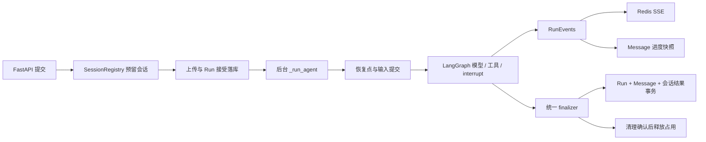

# Deskwork 本次架构改进与审查交接

> 更新：2026-11-10。本文件是本次重构的唯一交接文档，说明最终实现、验证证据与审查重点。它替代此前的设计草案、实施日志、验收报告及部署记录，不表示所有设计设想都逐字落实。

后续两轮独立审查发现的九项问题及修复验收见 [架构改造审查记录](deskwork-architecture-refactor-review-2026-11-10.md)。该记录补充本交接文档；其中后续修复尚未部署，下面的部署证据仍对应此前版本。

随后进行的[系统复核](deskwork-architecture-deep-review-2026-11-10.md)又确认 R10～R16 未解决，涉及文件隔离、远程停止、并行确认和请求状态等边界。本交接文档中的完成描述应结合这些未解决项阅读，不能作为整体验收通过证明。

## 1. 本次目标与审查范围

本次改进解决的核心问题是：任务控制、事件传输、展示历史、图状态和文件副作用之间的协调分散，导致运行链路难以追踪，异常与恢复路径容易出现不同步。

保留现有 Agent 能力：Skills、Memory、Multi-Agent、MCP、沙箱、人工确认、Checkpoint、SSE 续流、历史回退、文件版本、备份迁移、文档检索与引用、预览和 widgets。技术栈仍是单 FastAPI 进程、LangChain/LangGraph、业务 SQLite、Checkpoint SQLite、Redis 和 Docker/bwrap，没有新增分布式调度或插件框架。

审查基线为 `85cf427` 加任务开始时已有的工作区内容，目前变更尚未提交。请同时检查 `git diff` 与 `git status --short` 中的新文件；仅看 diff 会漏掉新增的运行时、数据库服务和恢复测试。

工作区原本已有下列改动，本次未编辑，不能直接归因于本次重构：

- `evals/cases/generation.yaml`、`evals/checks.py`、`evals/test_checks.py`。
- `sandbox/Dockerfile`、`sandbox_data/default_skills/pptx/SKILL.md`。
- 新增 PPT 评测/素材、`sandbox/fonts-local.conf` 及 `docs/01`～`07` 等已有专题文档。

本文件记录当前重构实现。已有专题文档可能仍描述重构前行为，不应代替实际代码作为审查依据。

## 2. 主要改了什么

| 改造 | 原问题 | 当前实现 |
|---|---|---|
| 统一任务事实 | Redis 状态、进程内多个集合、会话终态相互协调；幂等记录重启丢失 | 新增持久 `Run`；请求接受、幂等、错误和结果落业务 SQLite；内存 `RunHandle` 只管理实际 task、取消和操作占用 |
| 统一会话互斥 | 启动、删除、文件清理、导出各自检查忙碌，检查之后仍可交叉执行 | `SessionRegistry` 提供统一占用入口；从准备到收尾保持占用，不靠 Redis TTL 决定是否允许新运行 |
| 收敛异常和收尾 | 正常、失败、取消多处落库和发结束事件，Redis 故障可能跳过后续步骤 | `_run_agent` 使用集中 finalizer；终态和展示快照同事务保存，通知失败不代替数据库结果；无法确认清理时保留 `recovery_required` |
| 统一事件与展示 | 工具前言可能重复落库；刷新、续流、快照容易重复拼接 | `RunEvents` 统一正文去重、Run 内序号和快照；前端按 Run 合并，流过期时替换为已保存快照 |
| 改造历史回退 | 先切换图、再尽力恢复文件，恢复失败仍删历史；旧确认可能复用旧答案 | staging/backup/journal 协调文件与业务提交；普通回退选择历史 Checkpoint；历史确认重答复制必要图历史并清理旧回答 |
| 加固文件并发 | shell 串行，但宿主文件读改写与交付独立；取消协程不代表线程或远程脚本停止 | 工作区锁覆盖完整操作；文件临时写完再替换；等待实际 IO 结束后才释放锁；子 Agent bash 使用独立只读挂载 |
| 明确 Agent 依赖和预算 | 初始化顺序可能隐式使用内存 saver；无 usage 不计调用；子图/内部模型缺少统一统计 | 显式 `build_agent` 和 `RunContext`；未初始化 Checkpointer 明确报错；独立调用计数、共享 usage callback、恢复时延续逻辑 turn 预算 |
| 补齐兼容与部署 | 旧库、备份、代理路由和真实模型链路需要一起验证 | 编号数据迁移、备份 v4、新 Run 查询接口、nginx `/runs` 代理、数据库副本演练和实际部署验收 |

另外修复了三项具体问题：后端重复拼接已流过的工具前言；模型无 usage 时调用次数为零；快照只依赖大小/mtime，无法识别等长且保留时间戳的内容改写。快照现在包含文件内容摘要。

## 3. 当前状态归属与调用链

| 对象 | 当前职责 |
|---|---|
| 业务 SQLite `Run` | 持久请求接受、request_id 幂等、运行结果、错误、usage、逻辑 turn 和恢复关联 |
| `SessionRegistry` / `RunHandle` | 同进程任务句柄、取消标志、准备/收尾阶段、会话操作排他性；不具备多进程锁能力 |
| LangGraph Checkpoint | 模型消息、todos、节点位置、interrupt 与 pending writes；是图执行状态的依据 |
| SQLite `Message` / `UploadedFile` | 用户展示历史、附件引用、assistant 快照及其事件序号 |
| Redis Stream | 短期进度传输和按游标续读；新运行的业务状态和归属不依赖 Redis 状态键 |
| 文件系统 | 当前工作文件、轮次快照、交付副本和历史版本；SQL 中只保存引用及恢复元数据 |

`run_id` 沿用原 `prompt_id` 的值；`session_id` 表示用户会话和工作区；`turn_id` 表示原任务及其人工回答组成的逻辑轮次。回答 interrupt 产生新 Run，但继承原 turn。图的物理 `thread_id` 可在回退时改变，文件工具从 `RunContext.session_id` 获取工作区身份。



关键边界：`preparing`、`running` 和结果状态持久化；`finalizing`、`recovery_required` 等操作阶段由 handle 管理。waiting 表示本次执行片段结束、图等待回答，不是仍占着一个休眠 task。重启后不会自动重放任意 bash/MCP。

## 4. 需要理解的实现细节

### 4.1 接受、取消、恢复和关闭

[chat_operations.py](../../backend/app/services/chat_operations.py) 的 `start_chat` 校验请求指纹、预留会话、认领 owner、上传及校验回退输入，再记录 Run 并启动后台执行。request_id 使用会话内唯一约束；同 ID 不同内容拒绝，同内容返回原 Run。前端已删除“最近一条用户消息文本相同就算接受成功”的猜测，改查持久请求回执。

`_run_agent` 负责图驱动和集中收尾，`db/runs.py::save` 将 Run 结果、assistant 快照和会话展示结果放在同一业务事务。通知失败仍尝试保存终态，空正文失败也有可读记录。取消落在“SQL 已提交、accept 尚未返回”或“task 尚未进入协程”时，也会核对持久回执并收尾。

`complete_before_cancelling` / `file_io` 在等待者被取消后排空其拥有的 IO。关闭应用先停止接受新任务，再等待准备中的提交、文件/删除操作、Run finalizer 和辅助转换，最后关闭 shell、客户端和数据库。

`recover_interrupted` 保留已保存进度，将未完成 Run 转为可解释结果；图已经持久暂停、但提问事件尚未落展示历史时，从 Checkpoint 重建 ask 并恢复 waiting。恢复关系取自所选图状态及旧记录边界，不根据“最近 Run 恰好是 waiting”推测，因此失败回答不会重置预算。

### 4.2 SSE 与历史一致性

[runtime/events.py](../../backend/app/runtime/events.py) 在事件进入实时流和展示历史之前统一处理，附带 `run_id/seq/schema_version`；Redis ID 仍负责 XREAD 游标，seq 负责应用去重，两者用途不同。

中途定时保存脏快照，终态始终尝试保存。新流首次创建后，后续追加用 Redis 原子存在性检查，丢失的流不会被静默重建成缺少前半段的流。Run 有独立 heartbeat，任务互斥不依赖流 TTL。

新增/调整的接口：

| 接口 | 用途 |
|---|---|
| `GET /runs/{run_id}` | 持久状态、错误、已保存 parts 和序号；按会话 owner 校验 |
| `GET /conversations/{id}/requests/{request_id}` | 发送响应丢失后查原请求对应 Run |
| `POST /stream-events` | 保留原 start_id，流过期明确返回 410 |
| `POST /send-message` | 增加 mode、interrupt_id、rewind_mode，保留旧 prompt_id 返回 |
| `GET /thread-status/{session_id}` | 兼容现有前端，组合当前 handle 与最新持久 Run |

前端 `run.snapshot` 替换该 Run 的展示内容，seq 过滤已消费事件；缺失终止通知时查具体 Run 收敛。nginx 已转发 `/runs`，避免后端接口测试通过但浏览器拿到 HTML。

### 4.3 文件和对话回退

[services/rewind.py](../../backend/app/services/rewind.py) 的流程为：预检目标和附件 → 复制目标快照到 staging → 写 journal → 将旧目录保留为 backup 并安装新目录 → 业务事务截断历史、提交新用户消息和图选择 → 清理 backup/journal。

SQL 的 `input_committed` 是判定提交还是回滚的凭据。提交前失败恢复旧目录，提交后失败完成新状态收尾；启动时恢复 journal，恢复动作可以重复执行。文件快照不可用时要求用户明确选择 conversation_only，缺失上传原件也不会被自动忽略。`snapshot_ready` 与物理快照同时检查，防止未发布的残留快照被复用。

普通回退通过 `Conversation.graph_thread_id/graph_checkpoint_id` 选择恢复点，不为切分支随意补写图更新；空图回退创建新 thread。历史确认重答需要额外处理：旧答案及子图结果可能仍存在同一 Checkpoint 的 pending writes 中。

[agents/recovery.py::fork_answered_interrupt](../../backend/app/agents/recovery.py) 使用 Checkpointer 公共 API 复制历史，保留 Checkpoint/task 标识，定位 root 和嵌套图的暂停点，清理对应答案和被中断任务结果，保留已完成兄弟任务。复制后从新线程 head 恢复，而不是显式 replay；后者会重放已完成并行任务。复制目标先记 journal，未提交时删除临时线程。

工作区快照与交付版本继续分开：前者恢复 output/scratchpad，后者按交付时的 sha256 找回文件字节。旧版本被裁剪仍返回 410，不悄悄替换为最新版。文件内容摘要、原子复制与归档降级反馈均有相应调整。

### 4.4 Agent、安全和模型预算

[agents/agent.py](../../backend/app/agents/agent.py) 保留轻量 `create_agent` 组合，新增显式 `build_agent(model, checkpointer)`；lifespan 拥有资源生命周期。Checkpoint 未初始化不再自动降级为内存 saver。`RunContext` 携带 session/owner/run/turn/trace 和工作区模式，不序列化连接或 task。

Skills 的按需读取、Memory、MCP、摘要失败保留历史、模型 fallback 和 prompt caching 继续使用。没有新增通用插件框架，也没有要求主图与子图配置完全一致。

子 Agent 的 bash 在单独的只读 bwrap 视图执行，允许写私有 `/tmp`，不能改持久工作区；父 shell 的 cwd/env 不随之改变。主工作区的 shell 和宿主文件读改写共享工作区锁，目录 fd 遍历和 `O_NOFOLLOW` 加固后端直接文件 IO。Docker/bwrap 隔离与 manager 权限收口保留，未把 docker.sock 交回 backend。

调用次数不依赖 usage 是否存在，缺失 usage 有单独标记；callback 汇集主图、委派和内部模型响应，按响应 ID 去重，恢复时累计同一 turn 的预算。子 Agent 局部调用上限仍保留。预算异常和 `GraphBubbleUp` 不能被普通工具错误处理吞掉；未知异常只向模型/前端返回安全提示和 trace id。

新配置：`LLM_REQUEST_TIMEOUT_SECONDS=180` 控制模型 HTTP timeout；`AGENT_RUN_TIMEOUT_SECONDS=1800` 控制执行片段总时限，后者设为 0 可关闭。超时通过正常 finalizer 保存明确错误。

### 4.5 数据迁移、备份和删除

[db/migrations.py::migrate_runs](../../backend/app/db/migrations.py) 编号回填旧 Run。真实旧库存在引用已删除会话的孤儿消息：迁移保留原始记录，只回填有有效归属的 Run并记录跳过数量。旧 prompt_id 跨会话重复时不猜造映射；相关查询增加会话约束。

备份格式升级到 v4，携带运行元数据、输入是否提交和选中的 Checkpoint；继续读取 v1/v2/v3。导入重新分配 Run 标识并保留来源标识，支持 waiting 会话继续回答。Checkpoint 仍按现有类型白名单、包版本和图兼容规则校验，不因为重构放宽反序列化安全。

删除会话的 checkpoint、文件和 Redis 清理使用持久 pending marker，逐项重试；不能取消/确认清理完成时，不继续放行变更。Run 的线程关联用于清理回退产生的旧 thread。

## 5. 关键代码入口

以下是建议审查顺序；路径均相对仓库根目录。

| 文件/模块 | 关键内容 |
|---|---|
| `backend/app/services/chat_operations.py` | `start_chat`、`_launch_agent_task`、`cancel_chat`、`_run_agent`、`shutdown_runs`；主要协调仍在这里，没有另建通用调度器 |
| `backend/app/runtime/sessions.py` | `RunHandle`、`SessionRegistry`、`complete_before_cancelling`、`file_io` |
| `backend/app/db/models.py`、`db/runs.py`、`db/migrations.py` | Run/SchemaRevision、接受与终态事务、恢复关联、旧数据迁移 |
| `backend/app/runtime/events.py`、`services/history.py`、`utils/redis_utils.py` | 统一事件、正文投影、进度快照、追加/终止和流过期 |
| `backend/app/services/rewind.py`、`agents/recovery.py` | 文件恢复协议、图选择、确认重答和子图 pending writes |
| `backend/app/__init__.py`、`agents/agent.py`、`agents/checkpointers.py`、`agents/context.py` | 启动恢复、依赖装配、身份与资源关闭 |
| `backend/app/sandbox/`、`tools/executor.py`、`services/file_versions.py` | shell、文件锁、原子写、路径保护、快照和交付版本 |
| `backend/app/agents/middlewares.py`、`tools/task_tools.py`、`runtime/model_usage.py`、`services/budget.py` | 工具错误/控制流、子图隔离与共享预算 |
| `backend/app/services/session_import.py`、`session_export.py`、`conversation_cleanup.py` | v4 兼容、导入身份映射和持久清理 |
| `frontend/src/api/client.ts`、`stores/chat.ts`、`utils/turn.ts`、`types.ts`、`nginx.conf.template` | 发送回执、续流、快照替换、确认/回退 UI和代理 |

## 6. 已执行的验证

以下是已有执行结果，本次文档合并没有重新运行模型或服务，也不把通过测试等同于不存在任何其他缺陷。

- 后端完整测试 **893 项通过**；前端 **196 项通过**；TypeScript 检查、生产构建、Ruff、格式检查和 `git diff --check` 通过。
- `backend/tests/test_run_runtime.py` 覆盖持久幂等、流故障终态、准备取消、空失败、共享 gate和线程 IO 取消。
- `backend/tests/test_run_recovery.py` 使用真实 SQLite saver，覆盖重启提问恢复、错误答案与预算、确认重答、并行副作用、子 Agent 确认、临时图清理、旧库孤儿记录和跨会话 prompt 冲突等。
- `backend/tests/test_recovery_process.py` 用子进程 `os._exit` 模拟六个硬中断点：staging 完成、旧 output 移出、新 output 安装、两目录安装、业务提交、backup 清理中；新进程恢复并重复恢复后检查文件/图选择/历史一致。
- 数据库副本演练保留 53 个会话、154 条消息、22 条附件元数据和 0 条 Memory，新增 75 条 Run；重复初始化幂等，读取了三个旧会话的 Checkpoint。
- DeepSeek 隔离环境六组真实流程通过：提问与续流、重启回答、waiting 备份导入、编辑确认答案、完整空图回退及旧版本下载、完成会话导入后继续执行。
- 真实 Docker/bwrap、Redis和浏览器验证通过，包括只读挂载、私有 `/tmp`、取消关闭 shell、流丢失不重建、`/runs` 代理、刷新后历史只显示一份正文。

复现入口：

```bash
# 在仓库根目录运行
make backend-test
make backend-lint
make frontend-test
make frontend-build
```

`make check` 本身不包含后端全量测试，不能单独用它代表完整验收。

真实环境验收脚本为 `scripts/verify_refactor_runtime.py`、`scripts/verify_refactor_acceptance.py`、`scripts/verify_refactor_browser.cjs`。后两个需要 Docker/浏览器环境，`--model` 或浏览器发送会调用真实模型并产生费用；应使用隔离数据。此前临时 Playwright 安装位于 `/tmp/deskwork-refactor-browser/`，不是项目依赖。

## 7. 当前部署与证据位置

2026-11-10 已构建并切换实际 `backend/web`，访问 `http://localhost:8088`。Redis、sandbox和 sandbox-manager保持原运行实例。

当前默认 Anthropic 模型为 **`claude-opus-5-5`**，用户更新后的中转配置已通过工具调用及实际文件交付，没有切换 DeepSeek，也没有修改原 `.env`。旧分组曾超时，不能把旧记录误判为当前配置不可用。

部署后直连/代理健康、旧历史读取、请求幂等、SSE终态、精确文件字节、沙箱和浏览器均通过。随机验收数据已清理，最终原始表计数仍为 53/154/22/0，Run 为 75。

回滚及实际部署原始记录保存在：

`backend/data/deployment-20261110-095703/`

其中包含 `deployment-report.json`、`backup-manifest.json`、数据库快照、文件归档、镜像标签、浏览器记录和 `ROLLBACK.md`。备份在停服切换点生成，两个 SQLite 快照通过完整性检查；旧前端镜像缓存缺失时已从运行容器文件系统重建回滚镜像。含凭据的 private 配置只保留在受限备份目录，不应发给审查模型。

隔离验收原始结果及截图另在 `/tmp/deskwork-acceptance-qchqsawl/`；临时目录可能被系统清理。主要验证结论已汇入本文件，不要求审查者访问原始日志。

## 8. 请另一位 AI 重点审查什么

请独立核对代码和测试，优先报告可定位的正确性、并发、安全与兼容问题，并给出触发条件；不要仅因为新增文件或行数增加就判定架构改善，也不要直接接受本文件中的结论。

1. **状态与事务**：Run 接受、输入提交、终态保存是否有取消/commit 窗口；内存占用和持久事实是否一致；failed admission的展示记录、request_id唯一性及 owner 关联是否可靠。
2. **取消与 shutdown**：等待者取消后线程/远程脚本是否仍可能写入；锁、task和 finalizer的归属是否正确；二次取消、清理失败、删除/关闭交叉时是否过早 release或永久占用。
3. **回退协议**：每个目录替换和 SQL提交前后是否能恢复；journal凭据与 fork线程清理是否完整；snapshot_ready、磁盘错误和缺附件路径能否保留旧历史。
4. **确认与子图**：`fork_answered_interrupt` 对嵌套命名空间、pending writes和版本的假设是否成立；旧答案是否可能残留，已完成兄弟工具是否可能重放，导入/旧 Checkpoint的恢复来源是否正确。
5. **SSE投影**：序号、快照和终态之间是否存在丢字/重复窗口；断线、缺流、缺终止包、刷新与会话切换是否收敛；有无依赖“会话最新 Run”推断旧运行的问题。
6. **安全与隔离**：会话与 Run查询的 owner约束、符号链接及父目录替换竞态、主/子 Agent权限、MCP/陌生 URL确认、不可信结果边界和异常脱敏是否保持有效。
7. **迁移和备份**：孤儿记录、重复旧 prompt、NULL/空 checkpoint、v1～v4包、导入 ID映射、selected checkpoint和旧 thread清理是否兼容；备份恢复是否真的保持图与文件含义。
8. **复杂性与覆盖**：`chat_operations.py` 仍是主要协调入口；新增 Run/journal/fork是否减少了原有同步判断，是否还存在重复权威；测试是否过度依赖 mock，尤其是数据库故障、并行工具及外部资源的真实行为。

既有边界：系统仍只支持单进程；Checkpoint不自动回滚文件或外部 MCP副作用；历史版本和快照有保留上限；`recovery_required` 会阻止继续变更，环境恢复后需重启/恢复流程。进程硬中断已经测试，物理断电与存储损坏不是本次保证。真实模型验收覆盖固定测试任务，复杂文档质量和所有供应商组合仍应单独评估。
